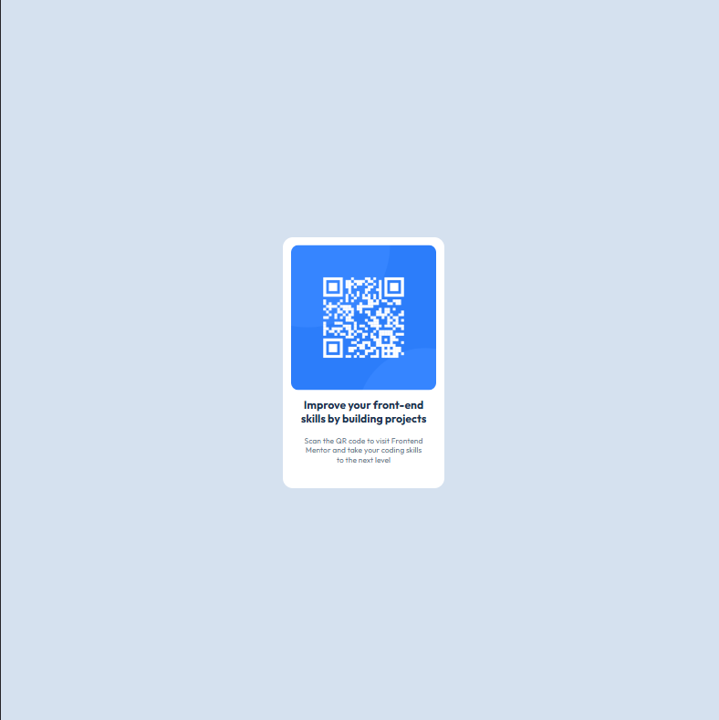

# Frontend Mentor | Componente de código QR

Esta es mi solución para el reto [QR code component de Frontend Mentor](https://www.frontendmentor.io/challenges/qr-code-component-iux_sIO_H). El objetivo fue construir una tarjeta con un código QR, respetando el diseño de referencia y adaptándola a pantallas de escritorio y dispositivos móviles.

## Vista previa

### Escritorio

### Móvil

## Enlaces

- [Repositorio en GitHub](https://github.com/JesuSaid/qr-code-component)
- [Sitio en vivo](https://jesusaid.github.io/qr-code-component/)

## Tecnologías utilizadas

- HTML5 semántico
- CSS
- Flexbox
- Diseño responsive
- Fuentes locales con `@font-face`

## Lo que aprendí

- A estructurar una tarjeta usando HTML semántico con un encabezado, un párrafo y texto alternativo para la imagen.
- A centrar contenido en la pantalla con Flexbox y a ordenar los elementos en columna.
- A entender el modelo de caja de CSS y usar `box-sizing: border-box` para que el `padding` no aumente las dimensiones planeadas de la tarjeta.
- A usar porcentajes para que una imagen ocupe el espacio disponible de su contenedor sin deformarse.
- A cargar y utilizar fuentes locales con `@font-face`, incluyendo una fuente de respaldo.

## Colaboración con IA

Utilicé Codex como guía de aprendizaje durante el desarrollo. Me ayudó a entender conceptos de HTML y CSS, detectar detalles de accesibilidad y recibir pistas para resolver problemas de diseño. Los cambios del proyecto fueron implementados y comprobados por mí.

## Autor

- GitHub: [@JesuSaid](https://github.com/JesuSaid)
